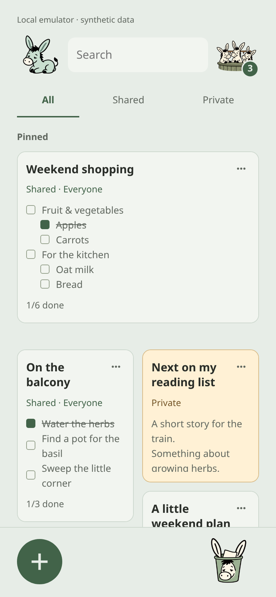
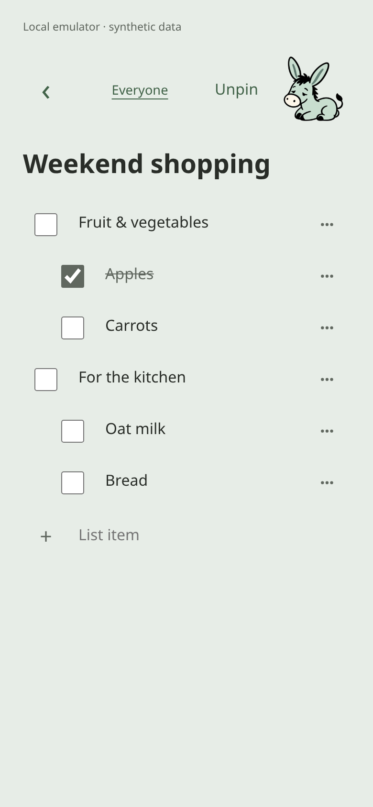

# Eselsohr

A small shared notebook with text notes, nested checklists and an offline app
shell. New notes are private; their creator can share with selected members or
everyone in the notebook. Built with TypeScript, Vite and Firebase.

**100% AI-generated application code.** The app was built by AI under human
direction. Third-party dependencies retain their own authorship and licenses.
AI-generated code can contain mistakes; review and test it before relying on it.

## Screenshots

<p>
  
  
</p>

The actual app running in Chrome at a mobile viewport, using local Firebase
emulators. All notes and accounts shown are synthetic; no real user data is used.

## Architecture


Firebase Hosting serves the static TypeScript/Vite app. The browser signs in
through Firebase Email/Password Authentication, then reads, edits and subscribes
to notes directly through the Firestore SDK. Firestore Security Rules enforce
active membership and each note's sharing policy. There is no application server
or Cloud Functions backend.

On the device, localStorage journals unsent draft changes, Firestore's IndexedDB
cache retains notes and queued writes, and a service worker caches only public
app files. Writes debounce for 650 ms; **Saved** requires server acknowledgement.
An offline launch needs a previously cached app shell. New notes are private;
their creator controls sharing, while recipients can edit shared content.

See [Architecture](docs/ARCHITECTURE.md) for modules, data paths, account changes
and update behavior.

## Get started locally

Use Node 24 LTS (24.15+), Java 21+ and desktop Google Chrome. Set `JAVA_HOME`
if Java is not on PATH. No Firebase account or production credentials are needed.
Clone this repository and enter its directory, then start the emulators:

```sh
npm ci
npx playwright install chrome
npm run emulators
```

In a second terminal in the same directory:

```sh
npm run seed:emulator
npm run dev:emulator
```

Choose a disposable password at the seeder's prompt. Open
<http://127.0.0.1:5173> and sign in as `alex@example.test`, `sam@example.test` or
`jo@example.test` with that password. `visitor@example.test` has no membership.
The first emulator launch downloads its runtime. All emulator data is synthetic
and disappears when the emulators stop. Stop both terminals with Ctrl+C when done;
automated tests start and stop their own services and need those ports free.

## Use your own Firebase project

Follow [Setup](docs/SETUP.md) for Authentication, Firestore, memberships and
explicitly targeted Hosting releases. This source repository grants no access
to an existing installation. Do not use real notes in tests or examples.

```sh
npm test
npm run test:rules
npm run test:acceptance
npm run test:release -- --project eselsohr-example --mode delivery
```

The last command builds with an inert configuration and checks local Hosting,
offline delivery and upgrades from older cached workers. It deploys nothing.
See [Testing](docs/TESTING.md) for focused checks and limitations, and
[Security](SECURITY.md) for dependency monitoring and reporting.

## Repository layout

| Path | Purpose |
| --- | --- |
| `src/` | Application logic, views and styles |
| `public/` | Installable-app manifest, icons and shipped artwork |
| `tests/`, `tools/` | Automated checks and development/deployment commands |
| `docs/` | Architecture, setup, testing, licensing and README images |
| `firebase.json`, `firestore.rules`, `firestore.indexes.json` | Firebase deployment configuration, access rules and query indexes |
| `.gitleaks.toml`, `.github/` | Secret-scan configuration and GitHub automation |
| `package*.json`, `*.config.mjs`, `tsconfig.json`, `index.html` | Dependencies, build/test configuration and browser entry point |
| `.env.example`, `.env.emulator`, `.env.delivery` | Example and synthetic local configurations |

Tool configuration stays at the root: Firebase's default index filename is
[`firestore.indexes.json`](https://firebase.google.com/docs/reference/firestore/indexes),
and [Gitleaks](https://github.com/gitleaks/gitleaks#load-configuration) discovers
`.gitleaks.toml` there. These files belong in source control. Put real installation
configuration in the ignored `.env.local`; never add administrator credentials.
Contributor and coding-agent guidance lives in [Contributing](CONTRIBUTING.md).

## Limits

Notes have no end-to-end encryption; Firebase project administrators can read
them. Sessions, cached notes and unsent drafts persist on the device. Use a
trusted device with a screen lock. Revoking access takes effect on reconnection
and cannot retract copied data. Edits to the same field use the last accepted
write; there is no conflict history. Saved means server acknowledgement.

One notebook, administrator-created accounts, text and checklists are supported.
There are no attachments, public invitations, self-service password recovery,
in-app exports or permanent note deletion. This source package does not include
the original installation's operator backup/scheduling tools. Arrange and test
your own database recovery before entrusting important data to a new instance.

## Reuse

Copyright 2026 PKehnel. Software is **source available for noncommercial use**
under [PolyForm Noncommercial 1.0.0](LICENSE). It is not an OSI open-source license.
The license expressly permits use by certain charitable, educational, research,
public-service and government organizations; read its exact terms.

Eligible documentation and shipped raster donkey artwork use
[CC BY-NC 4.0](LICENSES/CC-BY-NC-4.0.txt). Source SVG drawing and animation code
use the software license. See [licensing scope and asset origins](docs/LICENSING.md)
and [third-party notices](THIRD_PARTY_NOTICES.md). The private reference drawing
and unpublished artwork packs are not included or offered under these terms.

Changes are welcome under the applicable existing terms; read
[Contributing](CONTRIBUTING.md).
