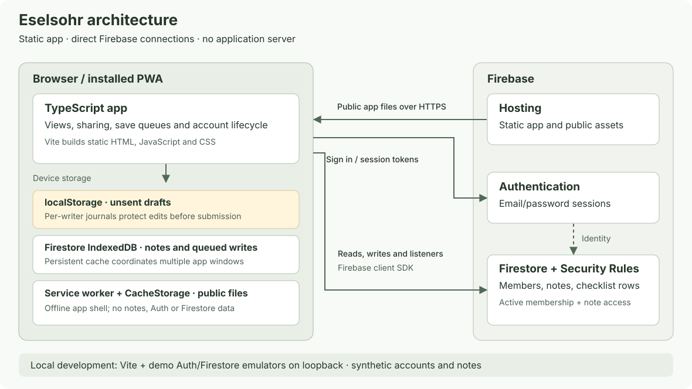

# Architecture

Eselsohr is a static TypeScript/Vite app. Browsers connect directly to Firebase
Hosting, Email/Password Authentication and Firestore using the modular SDK.
There is no application server or laptop hosting requirement. `index.html`
loads `src/main.ts`; terminal tools are never bundled into the app.



## Source map

| Source | Responsibility |
| --- | --- |
| `src/main.ts` | Account/membership lifecycle, routing, listeners, saves and Undo |
| `src/firebase.ts`, `auth.ts`, `device-cache.ts` | Firebase initialization, email/password sessions and coordinated cache lifecycle |
| `src/notes.ts`, `ordering.ts`, `outline.ts` | Queries, sharing transactions, stable ordering and checklist structure |
| `src/saves.ts`, `account-session.ts` | Per-document write queues, per-writer draft journals, recovery and cross-tab sign-out |
| `src/views/`, `src/styles.css` | DOM/dialog interface, gestures and donkey artwork/motion |
| `firestore.rules`, `firestore.indexes.json` | Server authorization, validation and query indexes |
| `firebase.json`, `tools/offline-build.mjs` | Hosting headers and generated public-shell worker |

## Stored data and authorization

```text
members/{uid}                         {displayName, active}
  notes/{noteId}                      legacy member-owned notes
    items/{itemId}                    checklist rows
notebooks/home/notes/{noteId}         new notes, initially private
  items/{itemId}                      checklist rows
```

No notebook parent document is required. Both namespaces retain their IDs and
support sharing in place. New notes have `audience: private` and include only
the creator in `sharedWith`. Selected notes include the creator and selected
UIDs, up to 100; Everyone uses an empty participant array. Everyone means active
members, including future ones, never anonymous users. Legacy owner notes
without sharing metadata remain private.

Only trusted administrators write membership records. Active membership plus
the note's sharing policy permits reading and editing; only its immutable creator
can change sharing metadata. Checklist rows inherit access from their parent.
Sharing uses an online transaction and detects stale previous access choices.
Broad unfiltered collection-group queries and unknown paths are denied.
Three listeners select Everyone notes, participant notes and the current
member's legacy notes, deduplicated after synchronized snapshots.

Note fields include immutable kind/creator, title (120 characters), body
(40,000), pinned/state/access metadata and timestamps. Checklist text is limited
to 1,000 characters; indentation is 0, 1 or 2, with legacy booleans supported.
Removing a parent promotes its children. Row Undo restores position using stable
sort metadata. Notes sort pinned first, then creation time and ID; edits do not
reorder them. Bin retains legacy `archived`/`trash` stored values.

## Saves, drafts and account changes

Input journals changed fields immediately in account-scoped localStorage.
Writes debounce 650 ms; blur/navigation/hiding flush them. Per-document queues
serialize patches, preserve recoverable failures and let newer corrections win.
Saved requires server-acknowledged writes and server snapshots for all current
note/row listeners. The donkey stays steady during normal pending saves;
connection problems and actionable errors remain distinct.

Firestore IndexedDB supports persistent multi-tab caching and submitted writes.
Separate per-writer journals protect edits still waiting for debounce or another
write. Web Locks identify live writers and serialize recovery of abandoned
journals; recovery copies durably before deleting its source. Cross-tab sign-out
freezes writers and waits for pending work; a four-second bound cancels a busy
attempt instead of discarding drafts.

Sign-out or confirmed membership loss closes participating readers before erasing
the account's device cache and coordination state. A generation prevents delayed
cleanup from deleting a reopened database. Startup repairs orphan SDK markers only
when no persistent database exists. A denied query alone is not proof of access
loss: the app checks the current member directly with the server before erasing
group data. Per-note revocation removes only that note's content/drafts.

## Interface and delivery

One main screen offers Search, People, All/Shared/Private filters and private
List/Text creation. Cards and editors show sharing scope. Native dialogs, labels,
focus fallback and 48px targets support keyboard and larger text. Motion is
optional, respects reduced motion and stops on interaction, hiding or teardown.
Acknowledged local actions may trigger short scenes; artwork never gates saving.
Undo lasts 2.5 seconds, paused during focus/press/hover or page hiding.

The generated worker hashes/caches only public build files. Auth, Firestore and
note data never enter CacheStorage. A complete install activates/claims clients
without reloading open editors. Navigation requests current HTML with no-cache;
offline/errors or a two-second stall fall back to the cached shell. Hashed assets
are immutable; HTML, worker, manifest and artwork revalidate. An offline cold
launch needs a successful prior shell install. Save and close/reopen old app
windows to adopt new code; installed launcher icons update separately.

Notes are not end-to-end encrypted and cached/copied content cannot be recalled.
Recovery and operational limits are in [Setup](SETUP.md); coverage and delivery
limits are in [Testing](TESTING.md).
